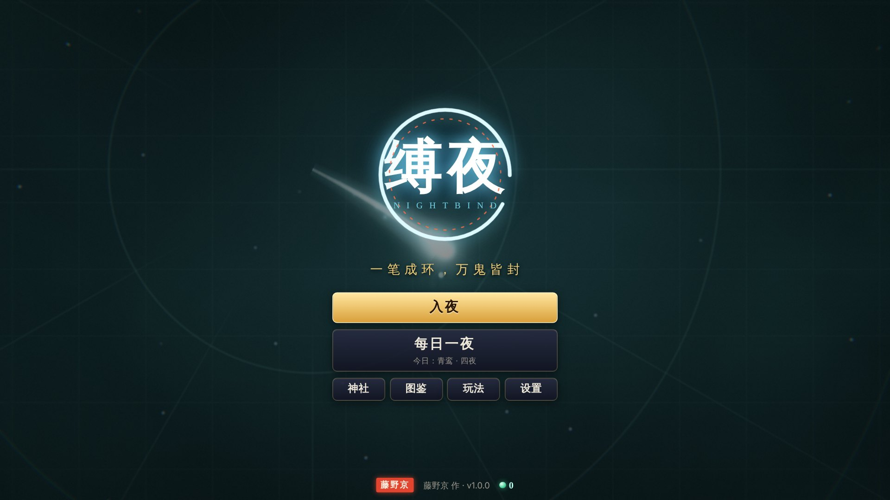
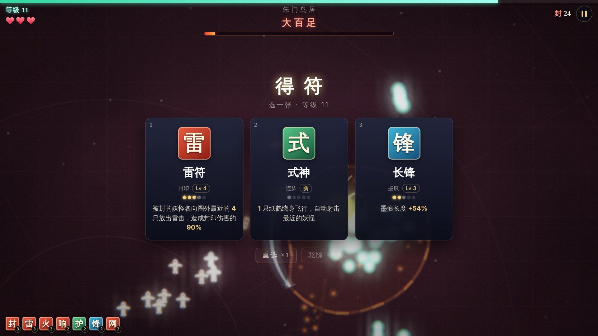
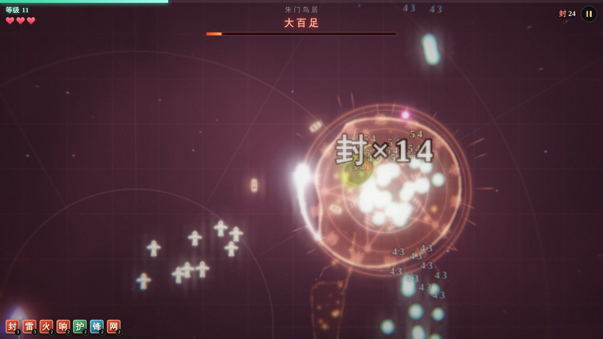
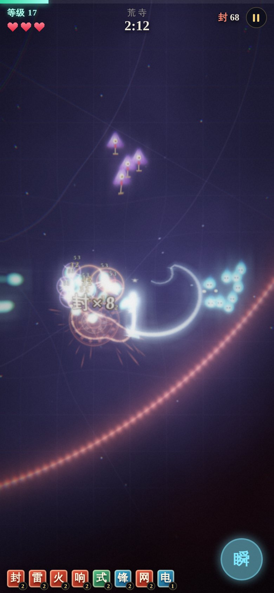

# 缚夜 · Nightbind

> 一笔成环，万鬼皆封。

**作者：藤野京**

一款画圈封印百鬼的俯视角动作肉鸽。整个游戏只有一个文件——[`缚夜.html`](./缚夜.html)，下载后双击，用浏览器打开就能玩；不需要安装，不需要联网，电脑和手机都可以。



## 怎么玩

你是一缕笔灵，在夜色里穿行，身后拖着一道发光的墨痕。

- **绕着妖怪画一个圈，让墨痕首尾相接**——圈里的妖怪当场被封印。
- **一圈套得越多，伤害越高。** 把它们引成一团，再一网打尽。
- 被碰到会受伤，墨痕也会震断；有些妖怪还会专门冲过来咬断它。
- **冲刺**时无敌，用来穿出包围。


| 操作 | 电脑 | 手机 |
| --- | --- | --- |
| 移动 | 鼠标指向 / WASD / 方向键 | 在屏幕上拖动 |
| 冲刺 | 空格 / 点击鼠标 | 第二根手指，或右下角的「瞬」 |
| 暂停 | Esc / P | 右上角按钮 |

## 一夜之内

- **五场、五个首领**：竹林夜径的百目、朱门鸟居的大百足、荒寺的大天狗、黄泉坂的九尾、百鬼夜行尽头的空亡。每个首领都要用不同的办法去圈。
- **十二种妖怪**，各有各的走法：会扑的提灯、一跳一停的伞妖、隔空吐弹的目目连、专断墨痕的镰鼬……鬼弹同样可以被圈住。
- **二十二张符**，升级时三选一，每张五级：雷符连锁、火符焚地、冰符冻结、回响再发、式神助战……同一局里最多持有八种，如何取舍就是流派。
- **六种进阶**：两张符都练到顶，可以合为更强的一张。
- **十四件神器**：每击败一个首领带走一件，往往改变整局的打法。



## 一夜之外

- **六位笔灵**，各有长短，靠战绩解锁：白狐、青鸾、玄龟、雷兽、灯灵、墨龙。
- **十夜**：渡过一夜，更深的一夜才会打开，一夜比一夜难。通关之后还可以继续**无尽夜行**。
- **神社**：用战斗得来的灵玉供奉九种庇佑，永久生效。
- **每日一夜**：每天一个固定的笔灵与种子，比一比今天的功德。
- **图鉴与三十项成就**。
- 中途退出也不要紧：每一场开始时自动存档，回来可以从这一场的开头续行。



## 手机

横屏竖屏都能玩，界面会自己适应，刘海与手势条也避开了。



## 关于这个文件

- 没有任何外部资源：画面全部由程序实时绘制（WebGL），音乐与音效全部实时合成。
- 存档在浏览器本地；「设置」里可以导出、导入存档文字。
- 中文 / English 可切换；可调音量、震屏、减弱动态、画质。
- 需要支持 WebGL 的浏览器（近几年的 Chrome、Edge、Safari、Firefox 都可以）。

## 源码

```
src/        源码（数据、模拟、渲染、界面、声音）
tools/      构建与测试脚本
缚夜.html    构建产物，也就是游戏本体
```

```bash
node tools/build.js          # 重新打包出 缚夜.html
```

```bash
node tools/test_engine.js    # 模拟层回归测试
```

```bash
node tools/sim.js 20 fox 1   # 让练习机器人打 20 夜，看看难度
```

浏览器端的流程测试与整夜浸泡测试（需要 Playwright）：

```bash
node tools/shot.js --steps tools/test_flow.js
```

```bash
node tools/shot.js --steps tools/test_soak.js
```

---

## English

**Nightbind** is a top-down action roguelite in a single HTML file: download [`缚夜.html`](./缚夜.html), open it in a browser, and play — on a computer or a phone, with no install and no network.

You are a brush-spirit trailing a line of light. **Draw a ring around the yokai and let your trail cross itself**: everything inside is sealed on the spot, and the more you catch in one ring, the harder it hits. Five stages and five bosses make a night; there are 12 kinds of yokai, 22 talismans in five levels with 6 evolutions, 14 relics, 6 spirits to unlock, 10 nights of rising difficulty, an endless parade, a shrine of permanent boons, a daily challenge and 30 feats. The interface is available in Chinese and English.

Move with the mouse, WASD / arrows, or by dragging on a touch screen; dash with Space, a click, or a second finger.

Created by **藤野京**.
