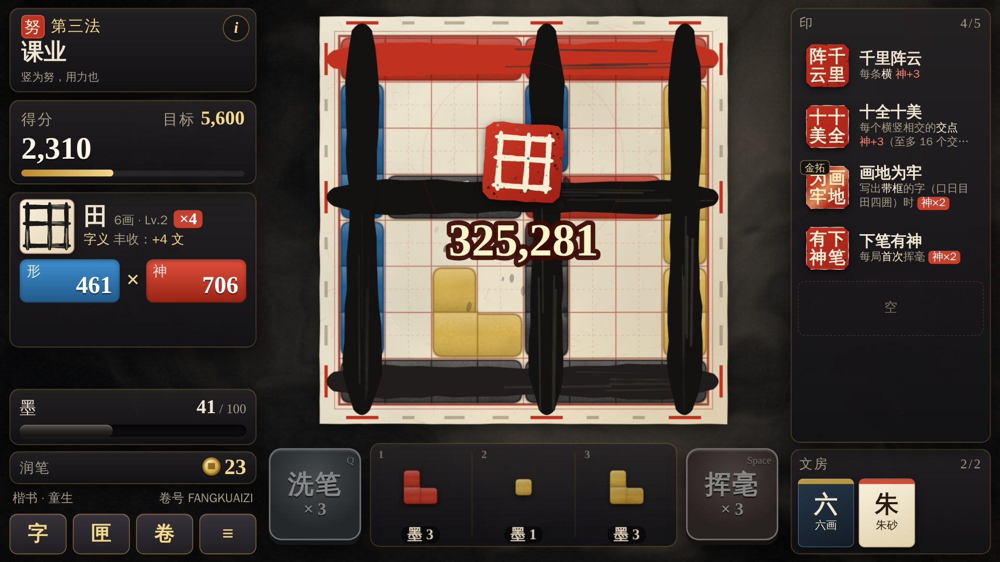
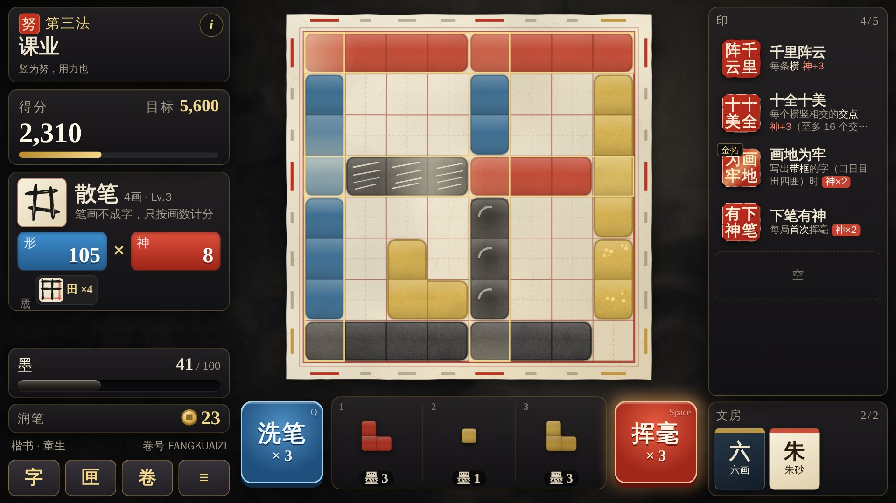

# 方块字 · Block Script

**落墨成笔，积笔成字。** 一款以书法为题的方块肉鸽——填满整行是一「横」，填满整列是一「竖」；挥毫之时，纸上所有的横竖合成一个汉字：一、十、王、井、田……每个字就是一手“牌型”。

作者：**藤野京**



## 怎么玩

**只需要一个文件。** 下载 [`方块字.html`](方块字.html)，用任意现代浏览器打开（双击即可）。不需要安装，不需要联网，电脑与手机、横屏与竖屏都能玩；进度自动保存在浏览器里，也可以在「设置」中导出为一段文字备份。

| 对局 | 文房铺 | 竖屏 |
| --- | --- | --- |
|  |  |  |

### 规则一页纸

- **落墨**：把墨块拖到纸上（轻点 / 右键 / 滚轮 / `R` 旋转）。每块墨耗去与格数相同的「墨」。
- **成笔**：填满的整行是「横」，整列是「竖」。
- **挥毫**：所有成笔的横竖一同计分并消去，合成一个字。笔画须与字的图样**完全吻合**——在纸边还是在中间都有讲究，多一笔少一笔就是另一个字，或是不成字的「散笔」。
- **得分 = 形 × 神**：字的画数定下基础的形与神；每个计分的墨格添形，横竖交点上的格计两次；整条笔画由同一种墨写成则为「纯色」，另有加成；最后乘以这个字的「字格」（王 ×3、田 ×4……）。
- **一卷八法**：一卷分八「法」，每法三局——习字、课业，与一张自带规矩的名帖（《兰亭集序》《祭侄文稿》《寒食帖》……）。在挥毫的次数用完之前达到目标分数即可过关。
- **文房铺**：过关得润笔，添置**印**（至多五枚，自左至右依次生效，是一卷的根本）、**字帖**（提升某一画数的等级）、**文房**（染色、赋予墨性、拓印、制格……）与整卷有效的**陈设**。

### 内容

- 45 个可以写出的字，各有来历、写法与字义——其中几个藏了起来，待你发现
- 107 枚印、29 件文房、7 种字帖、20 件陈设、28 张名帖
- 10 种书体（起手墨匣），其中有 7×7 的龟甲与 10×6 的长卷
- 8 重难度（童生 → 状元）、无尽之卷、每日一帖、自定卷号
- 图鉴、44 项成就与生平战绩
- 中文 / English

### 操作

| | 鼠标 / 触屏 | 键盘 |
| --- | --- | --- |
| 落墨 | 拖动墨块到纸上 | `1`–`4` 选块，方向键移动，`空格` 落下 |
| 旋转 | 轻点墨块 · 右键 · 滚轮 · 拖动时第二指轻点 | `R`（`Shift+R` 反向） |
| 洗笔 | 把墨块拖到「洗笔」上 | `Q` |
| 挥毫 | 点「挥毫」 | `空格`（未选块时） |
| 其他 | 长按 / 悬停查看墨块；计分时点击可加速 | `Z` 字典 · `X` 墨匣 · `C` 卷况 · `Esc` 暂歇 |

## 开发

游戏没有任何外部依赖：画面、字形、印章、纸张纹理与音乐音效全部由程序生成。源码在 `src/`，由一个脚本拼成单个 HTML 文件。

```bash
node tools/build.js          # 生成 方块字.html
node tools/test_engine.js    # 规则引擎回归测试
node tools/sim.js 200 kai 0  # 练习机器人打 200 卷，用于校准数值
```

界面测试用 Playwright 驱动真实页面（需自行安装 `playwright`）：

```bash
node tools/shot.js --steps tools/test_ui.js                        # 鼠标与键盘
node tools/shot.js --steps tools/test_ui.js --size 390x844 --touch # 触屏
node tools/shot.js --steps tools/test_flow.js                      # 教学、铺子、存档、语言、结局
node tools/shot.js --steps tools/test_soak.js                      # 机器人经由真实界面打完整卷
```

```
src/index.html      页面骨架
src/css/            样式
src/js/0x–1x        通用函数与内容数据（字、印、文房、名帖、书体）
src/js/2x           规则引擎（不依赖页面，可在 Node 中运行）
src/js/3x           存档、成就与界面文字
src/js/4x–5x        声音合成、程序化绘制、特效与背景
src/js/6x–9x        界面
tools/              构建、测试与数值模拟
```

---

## Block Script (English)

A calligraphy roguelike played with blocks. Fill a whole row and it becomes a horizontal stroke; fill a whole column and it becomes a vertical one. When you **flourish**, every complete line on the sheet joins into one Chinese character — 一, 十, 王, 井, 田 … — and each character is a "hand" with its own power. Build your box of ink blocks, your seals and your paper across eight principles, and write your way past the great masterworks.

**One file.** Download [`方块字.html`](方块字.html) and open it in any modern browser. No install, works offline, on desktop and phones, in either orientation. The interface is available in Chinese and English.

Made by **藤野京**.
